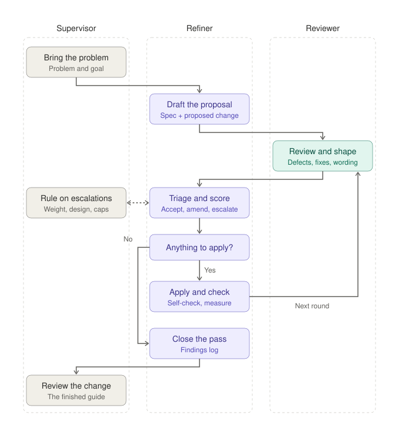

# Process Refinement Design

## Purpose

This document is the standard for SKAI's refinement guides: what they are for, how the process runs, and the decisions behind it. It is used to write and cold-review them; it is not something an operator reads at runtime.

- [`Guides/Process/process-refinement-guide.md`](../../Guides/Process/process-refinement-guide.md) — how the refiner runs a refinement.
- [`Guides/Process/cold-review-prompt-template.md`](../../Guides/Process/cold-review-prompt-template.md) — the prompt the refiner fills to commission each review round.

Backfilled 2026-11-13 from both guides at skai `v17-1-gea851e2`, with the changes decided for skai#90, #130, #135 and #136. Where a requirement below differs from the guides today, the guides change to match.

## Roles

- **Supervisor** — brings the problem and the change wanted, and rules on what the refiner escalates. A person or an agent can hold the role.
- **Refiner** — runs the refinement guide: drafts the proposed change, writes each round's review prompt, triages what comes back, applies fixes, scores rounds and keeps the findings log. It has the history.
- **Reviewer** — a fresh session the refiner commissions for each round. It has no history, reads the whole guide set and design spec cold, finds defects and shapes their fixes. It edits nothing.

## Goals

1. **Any guide change can go through it.** New guides, new content and changes to existing rules, not only repairs after a review. Whether a change uses it is the supervisor's choice; SKAI users are not required to use it.
2. **A fresh reader shapes the change.** An independent reviewer with no history reads the whole guide, so a change fits the whole process instead of being appended to it.
3. **Judged against a written standard.** Each guide has a design spec, and findings and changes are weighed against it.
4. **The reviewer finds the best whole solution.** Agents tend to fix every problem by appending a rule, and guides end up the equivalent of spaghetti code. The point is to push the reviewer away from rule bloat, not to stop it adding rules; sometimes a new rule is the best solution. The reviewer takes the incoming problem statement, proposed edits and caps and works out the best overall solution, free to refactor existing content to fit the new need as efficiently as possible while keeping the information architecture sound, the writing clear and the agent reliable. Tighter writing is the main way to cut size; dropping valid content or examples is a last resort, needing an argument that they add no value and the supervisor's approval. A change the supervisor asks for needs no proof that the problem recurs.
5. **The supervisor decides weight and design.** Fixes that add process weight, and contradictions in the design itself, go to the supervisor.
6. **Repairs are careful and checked.** A self-check after each group of fixes, and anything a script can check is checked before the next round.
7. **It stops on evidence.** A clean fresh round or a supervisor ruling ends the work.
8. **Settled ground stays settled.** A findings log carries decisions across rounds and passes so they aren't reargued.
9. **Record-keeping matches the problem; the core checks never drop.** A few clarity fixes need little bookkeeping and heavier structure comes only when the evidence calls for it, but every pass triages, self-checks, verifies and reviews to its stop rule; higher tiers add safeguards on top.
10. **Progress is measurable.** Each round's live defects are scored by how bad the outcome is, how likely an agent is to reach it, and whether the reviewer verified it or reasoned about it, so rounds in one series can be compared and the supervisor can see whether the guide is converging. The score never ends the work.

## Process Flow

The numbered steps below are the standard. The diagram is a picture of them for people; when the steps change, regenerate the diagram to match.

1. The supervisor brings a problem and the change wanted.
2. The refiner updates the design spec with what the change must say, and drafts the proposed change, including deletions of text it makes obsolete. It checks the draft against the design spec before any review.
3. **Review and shape.** The reviewer reads the guide set and design spec cold. In the first round it assesses the proposed change, which is not yet in the guide; in later rounds it reviews the guide with the last round's fixes applied. Either way it finds the defects and shapes a fix for each to the standard of goal 4, suggesting wording, and meets any cap mainly by tighter writing. There is one kind of round; compression is part of it, not a separate review.
4. The refiner triages each finding and its suggested fix: accept, amend or escalate. It decides the final wording and records why when it departs from the reviewer's suggestion. Escalations go to the supervisor: fixes that add process weight, contradictions in the design, anything that won't fit the cap, and dropping valid content or examples. It scores every round that reviewed applied text; the first round, on a proposal, is not scored.
5. While a round leaves anything to apply, the refiner applies it, self-checks, runs every mechanical check and measures size, then commissions the next round.
6. A fresh round over the current text that leaves nothing to apply, or a supervisor ruling on the remaining findings, ends the pass. The refiner closes it in the findings log, and the supervisor reviews the finished change.

So a pass that applies a change has at least two rounds: the first assesses the proposal, and only a fresh round over the applied text, the refiner's final wording in its surroundings, can end the pass. A pass with no proposed change, such as a review of a guide as it stands driven by observed failures, starts with a round over the current text. Each round's report covers the change; issues the reviewer finds outside it go briefly in an appendix and are triaged like any other finding.

## Refinement Guide Requirements

What `process-refinement-guide.md` must contain. Section names in the guide are free; the content is not.

### Entry

- **When to use it.** Any guide change the supervisor routes through refinement; whether a change goes through it, however small, is the supervisor's call.
- **What a fresh refiner reads.** This guide, the target's design spec, the guides under refinement, and the latest round's report.

### The Design Spec

- Every target has a design spec at `skai/refinement-reviews/<target-name>-design.md`, beside its findings log, so a later pass finds both by name. A target without one gets one before refinement starts.
- The design spec is the standard for every finding and every change. A guide that contradicts it is a defect; a finding that asks for something the spec deliberately decided against is weighed against the spec, not accepted automatically.
- Before drafting a change, the refiner adds to the design spec what the change must say.

### Commissioning A Round

- The refiner builds each round's prompt from `cold-review-prompt-template.md` and hands it to a fresh session. The reviewer gets only the prompt, the files it names and everything they or the proposed change reference directly, tool code included, which counts as part of the guide that cites it; never a file the prompt excludes (an excluded implementation leaves its tool claim reported as unchecked); and does not read this guide or the template unless they are the target.
- **Prompt fidelity.** The template's wording is used word for word: the refiner fills its sections and deletes whole sections that don't apply, adds no preamble, rephrases nothing and asserts no facts about the target. It diffs the prompt against the template before handing it off. A prompt that carries the refiner's framing hands the reviewer unverified premises.
- **Refreshed each round:** what changed since the last round, the settled decisions so far, the proposed change (first round only), and what the report covers.
- **When findings misfire, suspect the prompt.** Findings that demand content deliberately placed elsewhere mean the scope is missing; a settled decision coming back round after round means the settled decisions are missing. Fix the prompt and rerun; never patch the guide to satisfy a mis-scoped review.

### Records

- **Working document.** Each pass keeps a refinement working document, `<target-name>-refinement.md`, placed per `Guides/Core/working-doc-conventions.md`: the finding table, triage decisions, groups of fixes, the closure table and the score table; at the structured level also the invariants, the ownership table and each finding's impact map. A trivial pass may keep its table in the conversation instead.
- **Findings log.** One per target at `skai/refinement-reviews/<target-name>-findings.md`, committed, with no branch or session in the path, so a pass months later finds it. Every round's dispositions are appended to it, starting at round 1. It is never shown to the reviewer; the settled decisions extracted from it go into the prompt instead. At triage, a finding that restates a non-fix disposition gets a pointer to it and is skipped only if that disposition still stands after considering recurrence; one that restates a closed one and still reproduces is live again.

### Triage

- The refiner triages every finding before any edit. The review is aggressive by design and is not blunted; the refiner's critical second pass is what keeps it from being applied raw.
- **Categories:** `accept` (a real defect worth fixing), `log only` (a valid observation that doesn't meet the bar for a new rule; recorded, no guide change), `reject` (doesn't establish a live defect; reasoning from the documents alone is not grounds to reject), and `supervisor decision` (a live defect whose likely fix adds process weight: a new gate, a duplicate field, a checklist, a proof burden, extra validation, repeated re-approval), or one that drops valid content or examples.
- **Starting point.** The refiner starts from the reviewer's suggested fix and wording, decides the final wording, and records why when it departs.
- **New rules the review proposes.** Before accepting a new rule a review raises on its own, the refiner checks in order: does an existing rule already cover it (then sharpen that rule or add an example to it); is this a single observation (then log it and add a rule only on recurrence); does one principle cover the whole class (a third sibling rule means the principle was missed). This bar never blocks fixing a deterministic defect (a contradiction, a dangling reference, a design-spec requirement the text misses), never blocks sharpening a rule against a failure a review was commissioned on, and never applies to a change the supervisor asked for.
- **Stranded is not broken.** A gap that violates no requirement of this spec and only leaves the operator without an answer on a rare path, where the workflow already says to stop and escalate, is `log only` until it actually happens. Text that teaches a wrong action is fixed whatever its likelihood.
- **Findings from an observed run.** When the agent whose run produced the finding is still available, the refiner asks it, read-only, what led to the behavior before classifying the finding, and treats the answer as evidence, not authority. If it isn't available, the refiner records that.

### Supervisor Decisions And Design Contradictions

- For every `supervisor decision`, the refiner stops before editing and presents: the failure the reviewer is worried about, what already covers it, the smallest documentation fix, the heavier control-oriented fix, and a recommendation. The heavier fix is implemented only if the supervisor chooses it. The ruling is recorded and not reopened in the same pass.
- A finding that exposes a contradiction in the design itself is not repaired directly. The refiner frames it as a decision (the contradiction, the smallest decision that resolves it, the documents it ripples to), gets the ruling, updates the design spec, then repairs the guide.

### The Finding Table

- One row per defect, not per reported finding, with columns: defect, triage, what it touches (design spec section and guide section), the fix, and what must not change.
- **Collapse before counting.** Reported findings that are one defect become one row, which takes the whole label set of its heaviest finding (largest consequence × reachability × verification, ties broken by report order), never the strongest value on each axis separately.
- A finding that restates a logged defect is that defect: noise if its disposition stands, live again if a closure failed. Every reported finding keeps its mapping to a row so the log receives all of them.
- **Prefer examples over rules.** When a fix teaches a distinction, an example added to an existing rule is preferred over a new rule.

### Repairing

- The refiner applies accepted fixes in small groups of related fixes, one group at a time, and writes a self-check after each before starting the next: did it contradict nearby text or a sibling guide, leave a stale sentence teaching the old behavior, move a rule away from where the agent needs it, or weaken an enforced rule into a suggestion.
- No cleanup that isn't needed to close a finding.
- **Repeat findings.** When a fix in one round becomes the finding in the next, the refiner rewrites the affected step or sentence whole against the design spec instead of patching it again, and restructures the document only when the findings span more than one step. When that happens twice, the pass moves to the structured level.
- **Copied fixes.** A fix copied into a sibling guide joins the running round; the sibling's changed passage joins the review target, and the round stays in the same score series. Later prompts name that passage; the reviewer reads the whole sibling, but only the passage and what it references are binding.

### Size Caps

- A cap is optional. When the design spec sets one, it binds every fix: the refiner states each accepted fix's net size in the finding table and records the guide set's net change at closure.
- A cap is met mainly by tighter writing of the new and nearby text, or anywhere else in the document that can be improved. Dropping valid content or examples is a last resort and a `supervisor decision`, argued on the grounds that they add no value. Removing text that is wrong, duplicated or made obsolete by the change is an ordinary fix. A real fix that can't fit is a `supervisor decision`, never a silent overrun.
- The refiner re-measures with `wc -c` after applying, whatever the reviewer measured.
- How a cap is set is under *Decisions*.

### Checking Before The Next Round

- A review round is never spent on something a check could catch. Before commissioning the next round, the refiner checks every command and claim about a tool in the guide, failure handling included, against the tool's current code or documentation, without testing the tool itself; and searches the guide for every mention of a tool it changed.
- A defect class that shows up twice gets a script, run before every round and extended when it misses one.
- A round whose findings are mostly mechanical defects in the last repair is the sign this was skipped.

### Closing A Pass

- Every finding is marked `closed`, `downgraded`, `still open`, `rejected`, `deferred` or `logged`, each with a line of evidence. `rejected` and `logged` entries record the reasoning, because those are what a later review re-raises.
- A finding is not closed while its problem still reproduces under other wording. A finding about a command or tool is closed only when the guide's claim matches the tool's current code or documentation, failure handling included, never on a description of the fix.
- Every entry is appended to the findings log.

### Rounds And Stopping

- **Stop rule.** Only a fresh round over the current text can end a pass. It ends when (a) the round's triaged findings leave nothing to apply in the review target (re-raises are answered by the log; findings outside the target go to their owning document), or (b) the refiner presents the remaining findings it argues should not be implemented, as one ledger, and the supervisor approves; that ruling is recorded so ending by ruling is distinguishable from ending on a clean round.
- A round of misfired findings is a prompt defect, not a stopping point.
- **Watch who the findings are about.** A round whose findings are mostly the refiner's own last repairs is measuring the refiner, not the document; the refiner counts these every round.

### Round Score

- The reviewer never grades. It states three facts per finding, and the refiner computes: score = sum over the table's live rows of consequence × reachability × verification. Consequence: irreversible 20, divergent 5, cosmetic 2. Reachability: normal ×1.0, off-normal ×0.75, past-a-rule ×0.25. Verification: verified ×1.0, speculative ×0.5. The label definitions live in the template, which the refiner opens while scoring.
- The refiner corrects a label only when it plainly fails its test, before collapsing rows; otherwise the reviewer's labels stand.
- A row counts when triage says it is a live defect in the review target with no earlier disposition that still holds. Every other row is noise, counted beside the score and never added to it, so rejecting freely can't buy a clean round. Rows belonging to another document and open questions are neither.
- Every round on applied text is scored and recorded in a table (round, score, total defects, irreversible, divergent, cosmetic, noise) with the arithmetic on one line beneath it. The first round, on a proposal, is not scored.
- The score is a monitor, never the stop criterion. Scores compare only within one series; a series is fixed by the scoring model, the files under review, the design spec and scope, the report charter, and any evidence the commission supplies. Changing one starts a new series. Repairing the reviewed text, routine refreshes of the prompt, and a copied fix joining the round stay in series.

### Record-Keeping Levels

- **Lightweight (default):** triage, the finding table, groups of fixes with self-checks, the closure list and the findings log.
- **Structured:** when the repeat-finding trigger has fired twice, or a round's findings are mostly the refiner's own last repairs. Adds invariants with stable IDs (every accepted finding restated as a violation of one before editing), a table of where each rule lives and which surfaces restate it, and an impact map per finding (the invariant, the rule's home, every dependent found by search, what must not change). Fixes sweep the whole class, not the instance found.
- **Full apparatus:** a dated worklog, a numbered audit catalog, required stale-text sweeps, simulated cold readers and explicit stop conditions consistent with the stop rule, for structural repairs across several guides.
- Every level triages, self-checks, checks mechanically and reviews to the stop rule; the structured and full levels add the safeguards above.

### Across Passes

- A rule raised by review findings is added only on recurrence: a first sighting is logged, a second in a different case is considered, a third can be codified. This never blocks fixing a deterministic defect, sharpening a rule against a commissioned failure, or a change the supervisor asked for.
- Every several passes, a separate pass restructures the guide: consolidating overlapping rules, removing dead text, and reorganizing by what carries weight.

### Project Addendum

- The guide ends with the standard Project Addendum section.

## Review Prompt Template Requirements

What `cold-review-prompt-template.md` must contain.

### For The Refiner

- It is refiner-facing; the reviewer never reads it, except when it is the review target.
- **Fill-in sections**, each with a short note on what goes in it and why it matters:
  - target name; the guides under review (the review target); the design spec (the standard);
  - scope: what the target covers and what deliberately lives elsewhere (the most common cause of a review that never converges when missing);
  - context files (marked not binding);
  - settled decisions: decisions only, never the findings log (the second most common cause of non-convergence when missing);
    - the supervisor's problem and the change wanted, then what recently changed; failure modes to check; the workflow steps a fresh operator walks; legacy artifacts;
  - files the reviewer must not read, to keep it cold: always the findings log and, unless they are the target, both refinement guides, plus other history it could reach by search or reference.
- **Optional sections**, each deleted when unused:
  - observed failures: input, output and expected result per failure, facts only, no diagnosis;
  - the proposed change, quoted in full with where it goes; the normal first-round input, not tied to observed failures;
  - what the report covers; findings outside it go briefly in an appendix;
  - size caps: each guide's cap and current size, with the fixed instructions under *Decisions*.
- **Word-for-word use.** The prompt block is used verbatim, with only its sections filled or whole sections deleted, and diffed against the template before handoff. The template says why: a refiner who rewrites the prose hands the reviewer its own unverified premises.

### In The Prompt

- **The task.** A fresh-eyes critical review of the named target, from the named files, the proposed change and what they reference only; no edits to any file. The reviewer finds gaps, ambiguities, contradictions, information-architecture problems, weak enforcement and places a fresh agent would misuse or skip the process, and shapes a fix for each.
- **The charge (goal 4).** Find the best overall solution for the change and each defect: refactor existing content to fit the need as efficiently as possible, keep the information architecture sound, the writing clear and the agent reliable, and avoid rule bloat without ruling out a new rule where it is the best answer. Suggest the wording of each fix. The maintainer decides what to apply.
- **The standard.** The design spec; where guide and spec diverge, that is a finding, with a note on which side looks wrong.
- **Scope.** Findings that amount to inlining content that deliberately lives elsewhere are out of scope; name the boundary instead.
- **Legacy artifacts** are history, flagged only when current docs still route operators to them, blur active and historical material, or depend on them confusingly.
- **Settled decisions** are not raised again; one that seems to cause a real defect gets one brief open question.
- **Observed failures** are fact as observations, not as causes, and join the standard; fixes must generalize, never encode the listed cases.
- **The proposed change** is hypothetical, not in the files; the reviewer endorses, amends or rejects it and recommends something else where needed.
- **Editing discipline**, the same the refiner follows:
  - the three-question check before recommending a new rule;
  - a preference order: remove text that is wrong or duplicated, or move a misplaced rule to where it is used · sharpen existing wording · add a worked ❌/✅ example · restate a rule at its point of use · add a new rule, gate or required field;
  - stranded is not broken;
  - root causes before symptoms, one fix per cluster;
  - a churn guard per fix;
  - a self-check per fix;
  - no cleanup beyond what closes the finding.
- **Size.** When caps are set: meet them mainly by tighter writing; propose dropping valid content or examples only as a last resort, with an argument that they add no value, for the supervisor to approve; give each trim as exact before and after; apply the trims to a copy in a temporary folder outside the repo, measure with `wc -c`, and report the measured size.
- **Three review modes:** a static architecture review; a fresh-operator walkthrough of the workflow steps (primary); a legacy-encounter walkthrough when legacy artifacts exist.
- **Tool claims.** Where a guide or proposed change says what a tool enforces or produces, the reviewer reads the implementation and confirms it; command syntax is left to mechanical checks, but a command that does something other than the prose claims is a finding. Nothing mutating, destructive or costly is run; the temporary measuring copy is the only file written. Each finding is marked verified (implementation read or command run, quoted) or speculative.
- **Output:**
  - root causes;
    - findings, every defect found rather than the most important few (supervisor, 2026-11-13, after a comparison showed under-reporting), each with problem and risk (verified or speculative), consequence, reachability, the recommended fix with suggested wording, a churn guard, a triage call (`accept`, `log-only`, `supervisor-decision`) and a bloat flag when the fix adds a rule, gate or required field;
  - walkthrough results;
  - open questions;
  - a verdict, including the verdict on any proposed change.
- **Score labels.** Consequence and reachability are stated as facts with their tests in order, first match winning. Consequence: `irreversible` (destroys work or leaves the effort's records unrecoverable or not comparable), `divergent` (the operator stops, two operators do different things, or every operator reaches the same wrong outcome), `cosmetic`. Reachability: `past-a-rule` (only by going against a clear, unopposed rule), `normal` (the main path, including a step taken every round), `off-normal` (a branch reached only on a triggering event). The reviewer does not rank findings against one another; a finding with no proportionate fix is marked `log-only` with the reason.
- **Style.** Direct and critical, findings over summary, exact paths and lines, verified kept apart from speculative, nothing softened.

### Project Addendum

- The template ends with the standard Project Addendum section.

## Size Caps

Measured with `wc -c` on 2026-11-13: `process-refinement-guide.md` 26,556 bytes; `cold-review-prompt-template.md` 18,489 bytes. Neither had a cap. Caps approved by the supervisor 2026-11-13, after the first round of the skai#90/#130/#135/#136 pass and a cleanup with approved cuts: `process-refinement-guide.md` **22,800 bytes**; `cold-review-prompt-template.md` **18,489 bytes**. Raised by the supervisor 2026-11-14, so wording compressed to fit could be restored: `process-refinement-guide.md` **24,000 bytes**; `cold-review-prompt-template.md` **19,500 bytes**. Template raised by the supervisor 2026-11-15, for the round 19 fixes: `cold-review-prompt-template.md` **19,600 bytes**.

## Decisions

- **Self-review.** When refinement reviews its own guides, the reviewer reads both files as the review target; the ban on reading them exists to keep a reviewer of another guide unbiased.
- **Fix wording.** The reviewer is encouraged to suggest the wording of each fix; the refiner decides the final wording and records departures.
- **Size caps are optional.** A cap, when set, goes to the reviewer with fixed instructions: meet it mainly by tighter writing; propose dropping valid content or examples only as a last resort, with an argument that they add no value, for the supervisor to approve; give each trim as exact before and after; apply the trims to a copy in a temporary folder outside the repo (made with `mktemp -d`), measure with `wc -c` and report the measured size. That temporary copy is the only file the reviewer writes.
- **Setting a cap.** For a new guide, the cap is set a little under the size the first round settles on, so every addition has to be worked for. For an existing guide, it is the old cap (or, for a guide never capped, its size before the change) plus the settled addition, trimmed a little. When a change sets or revises a cap, the refiner proposes it after triaging the first round and before applying it, measuring the settled shape on a temporary copy, in a table of before size, settled size, change, old cap and proposed cap; the supervisor approves it, and it is recorded in the design spec before the change is applied.
- **Copied fixes.** A fix copied into a sibling guide joins the running round; the sibling's changed passage joins the review target and the round stays in the same score series.
- **Repeat findings.** When a fix in one round becomes the finding in the next, the refiner rewrites the affected step or sentence whole against the design spec instead of patching it again, and restructures the document only when the findings span more than one step. A second firing moves to the structured tier.

## Decisions From The Audit Pass (2026-11-13)

- **Completeness.** The prompt asks the reviewer for every defect it finds, not the most important few. Reviews run at the highest reasoning effort the reviewer model offers; the model itself is the supervisor's choice and not named in the guides.
- **Default report scope.** Without a charter, the report covers the change, or the whole target when there is none; findings outside it go in an appendix with the same fields.
- **Tool claims.** Mechanical command defects are left to the maintainer, but a command whose documented behavior is wrong, an exit status or guard included, is a finding.
- **Repairing.** The settled proposal is applied with the accepted fixes, even when round 1 reports no findings.
- **Structured tier.** A round whose findings are mostly the refiner's own last repairs moves the pass to the structured tier, stated where the refiner counts them.
- **Canonical ownership.** Each rule has one home; a restatement a surface needs (the reviewer's prompt, which can't read the guide) is kept consistent with it.
- **Revising a cap.** Round 1 of a change that revises a cap gets current sizes only; the reviewer writes as tightly as it can, and the new cap is set after triage.
